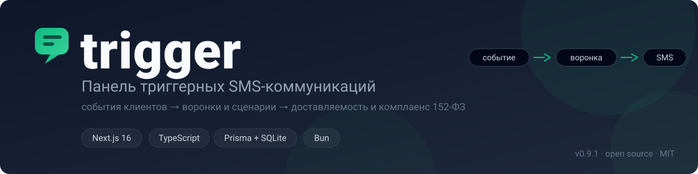
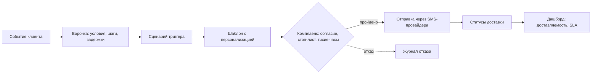

<p align="center">
  
</p>

<p align="center">
  
  
  
  
  
  
</p>

Open-source-система автоматизированных SMS-коммуникаций (Next.js + SQLite):
по входящему событию (просрочка, приближение платежа, поступление платежа,
закрытие займа, день рождения, преапрув) обновляет карточку клиента и
запускает **воронки** — цепочки SMS с задержками, ветвлением и комплаенсом
по 152-ФЗ и закону «О рекламе».

Подходит микрофинансовым и кредитным организациям, сервисам с абонентской
базой и любому бизнесу, где нужны событийные уведомления клиентов по SMS.

> **Только синтетические данные.** В репозитории и демо-базе нет реальных
> ФИО, телефонов и персональных данных — всё сгенерировано для демонстрации
> (152-ФЗ). Проверяйте, что заливаете в тестовую базу.

## Как это работает



Событие приходит по REST API (`/api/v1/events`) или через приёмник
«Захват событий», обновляет карточку клиента и прогоняется по воронкам.
Сработавший сценарий персонализирует шаблон, проходит комплаенс-проверки
(согласие на рекламу, стоп-листы, тихие часы, лимиты) и отправляет SMS через
подключённого провайдера; статусы доставки возвращаются в дашборд и отчёты.

## Возможности

- **Конструктор воронок** — шаги SMS с задержками (минуты/часы/дни), ветвления
  «отправить/пропустить», условия по полям карточки; 9 предустановленных типов
  событий (просрочка, платёж, закрытие займа, ДР, преапрув + 4 категории).
- **Карточка клиента** — профиль, заявка, договор, преапрув, счётчики,
  согласие на рекламу, статус отписки, таймзона; обновляется каждым событием,
  алиасы имён полей и «радар» незнакомых полей (unknown-fields).
- **Сегменты** — конструктор условий по любым полям карточки и кастомным полям
  (`cf_*`), мгновенный предпросмотр аудитории, заморозка, день рождения
  («через N дней» — SQL-быстро через служебный календарь).
- **Рассылки по сегментам** — ретаргет-кампании с прогрессом, пауза/резюме/
  отмена, ретеншн журнала доставки с gz-архивированием.
- **Шаблоны** — переменные `{{client_first_name}}`, `{{cf_*}}` с подсказками
  и демо-значениями, локальный и серверный предпросмотр.
- **Комплаенс из коробки** — рекламные/сервисные сообщения различаются:
  отписка и отключённая реклама блокируют ТОЛЬКО маркетинговые SMS
  (напоминания об оплате доставляются всегда); обязательная приписка
  «Реклама. {рекламодатель}. Отказаться: {ссылка}» с короткими ссылками
  отписки, тихие часы, лимиты на клиента и системы в сутки.
- **SMS-провайдеры** — SMS.Tech, Т2 «Бизнес SMS», МТС OmniChannel, песочница
  (sandbox-имитация для разработки); креды в БД зашифрованы AES-256-GCM.
- **Приём событий** — REST API (`/api/v1/events`, batch до 10 000 строк),
  API-ключи с лимитами, идемпотентность, приёмник внешних событий
  («Захват событий») с дедупликацией и отписками по `unsub_sms`.
- **Обратный поток** — форвардер статусов доставок во внешний приёмник
  (BI-аналитика), батчи, ретраи, дедупликация.
- **Безопасность** — роли ADMIN/MANAGER/VIEWER, сессии HttpOnly-cookie +
  Bearer-фолбэк, журнал аудита, брутфорс-лок, история и политика паролей,
  rate-limits, HTTP-заголовки безопасности (CSP/HSTS/…).
- **Документация** — встроенное руководство на 20 разделов прямо в панели
  («Документация»), договор API, руководство разработчика.

## Стек

| Слой | Технологии |
| --- | --- |
| UI | Next.js 16 (App Router) · React 19 · Tailwind CSS 4 · shadcn/ui · TanStack Query |
| Домен | TypeScript 5 (strict) · Zustand · Recharts |
| Данные | Prisma 6 ORM · SQLite · ретеншн журнала с gz-архивированием |
| Runtime | Bun (разработка, скрипты) · Node (прод, standalone-сборка) |

## Структура проекта

```
src/app          маршруты App Router: интерфейс панели и REST API /api/v1
src/components   UI: компоненты shadcn/ui и представления модулей
src/lib          домен: клиенты, воронки, сценарии, комплаенс, провайдеры SMS
prisma/          схема БД и сиды синтетических демо-данных
scripts/         e2e-тесты рассылок, нагрузочные прогоны, диагностика кредов
deploy/          build-archive.sh · install.sh · update.sh
docs/            договор API, гайд разработчика, модель безопасности
```

## Быстрый старт (разработка)

```bash
cp .env.example .env        # заполнить секреты (см. комментарии)
bun install
bun run db:push             # создать схему
bun run db:seed             # синтетические демо-данные (только dev)
bun run dev                 # http://localhost:3000
```

Вход: `ADMIN_EMAIL` / `ADMIN_PASSWORD` из `.env` (при первом входе панель
потребует смену пароля). Демо-данные: 12 клиентов, воронки, шаблоны, сегменты,
SMS-журнал.

## Развёртывание (свой сервер)

Сборка распространяемого архива на машине разработки:

```bash
bash deploy/build-archive.sh   # → download/trigger-v<версия>.tar.gz (+ -src.tar.gz и git-бандл)
```

На целевом сервере:

```bash
tar xzf trigger-v*.tar.gz
cd trigger-v* && bash deploy/install.sh   # зависимости, .env со сгенерированными секретами, схема, админ
PORT=3000 node .next/standalone/server.js
```

Для постоянной работы — PM2 (`pm2 start .next/standalone/server.js --name trigger`)
или systemd (пример юнита — в README архива). Обновление версий — `bash
deploy/update.sh trigger-v<новая>.tar.gz` (резервирует .env и БД).

Подробности: `docs/developer-guide.md` (§12), `docs/security.md` (чек-лист
разворачивания: TLS, firewall, права на каталог БД, резервные копии).

## Документация

- `docs/api-contract.md` — полный договор REST API `/api/v1/*`
- `docs/developer-guide.md` — архитектура, домен, dev-процессы
- `docs/security.md` — модель угроз и защита
- Встроенное руководство пользователя — вкладка «Документация» в панели

## Лицензия

MIT — см. [LICENSE](LICENSE). SMS-агрегаторы и операторы подключаются по
своим договорам; проект не аффилирован с ними.

## Дисклеймер

Проект создан для внутренних задач автоматизации коммуникаций и публикуется
как есть. Проверьте применимое законодательство (152-ФЗ, закон «О рекламе»,
отраслевые требования) перед использованием на реальных данных.
